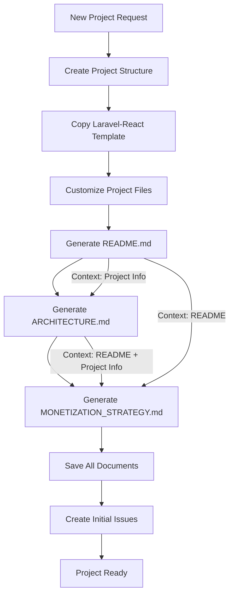
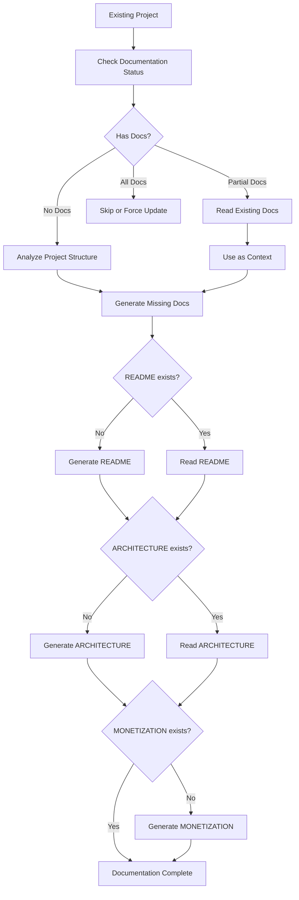

# Documentation Generation Flows

## 1. New Project Creation Flow



### Detailed Steps:

1. **Project Creation** (`local_project_creator.py`)
   - Creates project from Laravel-React starter template
   - Customizes basic files (package.json, composer.json)
   - Sets up initial project structure

2. **README Generation** (`generate_all_docs.py:_generate_readme`)
   - **Input**: Project name, description, tech stack, detected features
   - **Output**: Professional README with:
     - Project overview
     - Installation instructions
     - Usage examples
     - Configuration guide
   - **Context Used**: Basic project information only

3. **ARCHITECTURE Generation** (`generate_all_docs.py:_generate_architecture`)
   - **Input**: Project info + README content
   - **Output**: Technical architecture document with:
     - System overview
     - Core components
     - Database design
     - API endpoints
     - Security architecture
     - **Key Features section** (used by monetization)
   - **Context Used**: README content for consistency

4. **MONETIZATION Generation** (`generate_all_docs.py:_generate_monetization`)
   - **Input**: Project info + README + ARCHITECTURE
   - **Output**: Monetization strategy with:
     - Pricing tiers based on ARCHITECTURE features
     - Revenue models aligned with technical capabilities
     - Market analysis
     - Growth projections
   - **Context Used**: 
     - README for overview
     - ARCHITECTURE for features and capabilities

## 2. Existing Project Update Flow



### Detailed Steps:

1. **Project Analysis** (`generate_all_docs.py:_analyze_project_comprehensive`)
   - Scans for existing MD files
   - Reads metadata.json, package.json, composer.json
   - Detects tech stack and dependencies
   - Analyzes directory structure
   - Extracts features from file/folder names

2. **Existing Documentation Check** (`_check_existing_docs`)
   - Checks for README.md
   - Checks for ARCHITECTURE.md
   - Checks for MONETIZATION_STRATEGY.md
   - Determines which need generation

3. **Context Building**:
   - If README exists → Read and use as context
   - If ARCHITECTURE exists → Read and use as context
   - Missing docs are generated with available context

4. **Generation with Context**:
   - **Missing README**: Generated from project analysis
   - **Missing ARCHITECTURE**: Generated with README context (if available)
   - **Missing MONETIZATION**: Generated with both README and ARCHITECTURE context

## 3. Key Differences Between Flows

### New Projects:
- Start with clean slate
- All docs generated in sequence
- Full context flows from one to next
- Consistent narrative across all docs

### Existing Projects:
- May have partial documentation
- Reads existing docs for context
- Fills gaps while maintaining consistency
- Preserves existing content (unless force=True)

## 4. Feature Extraction for Monetization

### From ARCHITECTURE.md:
```python
# Looks for these patterns:
- ## Features
- ## Key Features  
- ## Feature
- ### Key Features
- ## Core Components
- ## Key Components
- ## API
```

### Context Building:
```python
architecture_context = f"""
Architecture Overview:
Key Features from ARCHITECTURE:
{features_section[:800]}

Core Components:
{core_components[:500]}

API Design:
{api_design[:500]}
"""
```

## 5. Commands to Use

### For New Project:
```bash
# Create new project with all docs
python3 scripts/local_project_creator.py
# This automatically generates all 3 MD files
```

### For Existing Projects:
```bash
# Generate missing docs for single project
generate_all_docs(operation='generate', project_name='my-project')

# Generate missing docs for all projects
generate_all_docs(operation='batch', skip_existing=True)

# Force regenerate all docs
generate_all_docs(operation='generate', project_name='my-project', force=True)

# Update existing docs with new info
generate_all_docs(operation='update', project_name='my-project', doc_type='all')
```

## 6. Important Notes

1. **Feature Source**: Features for monetization come from ARCHITECTURE.md, NOT README.md
2. **Context Flow**: Each document uses previous ones as context
3. **Preservation**: Existing detailed docs are preserved unless force=True
4. **Alignment**: Monetization pricing aligns with actual technical features
5. **Batch Processing**: Can process multiple repositories efficiently