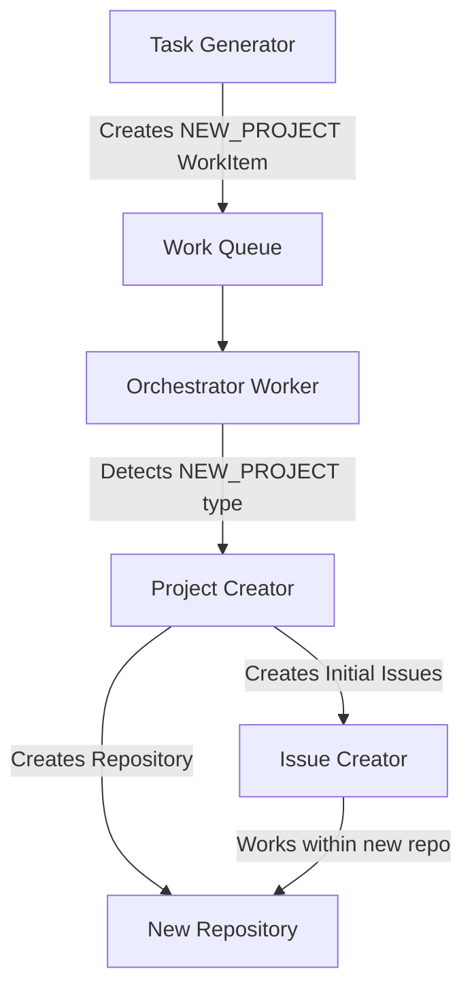

# NEW_PROJECT Task Flow Documentation

## Overview

NEW_PROJECT tasks are special work items that create entirely new repositories, not issues within existing repositories. This document clarifies where these tasks should be generated and handled.

## Where NEW_PROJECT Tasks Are Generated

### 1. Intelligent Task Generator (`intelligent_task_generator.py`)
- **When**: No suitable existing repository is found for a task
- **Example**: User needs a "recipe sharing app" but no existing repo matches
- **Code Path**: `_generate_new_project_task()` method

### 2. Enhanced Project Opportunity (`enhanced_project_opportunity.py`)
- **When**: System identifies market opportunities for new projects
- **Example**: Detects demand for a "crypto portfolio tracker"
- **Code Path**: Generates through research and market analysis

### 3. Custom Monetization Tools
- **When**: Explicitly requested via custom tools
- **Tools**:
  - `create_monetized_project.py`
  - `evaluate_project_opportunities.py`
  - `portfolio_monetization_report.py`

## Where NEW_PROJECT Tasks Are Handled

### ✅ CORRECT Handlers:

#### 1. Continuous Orchestrators
- `continuous_orchestrator.py` → `_execute_new_project_task()`
- `continuous_orchestrator_no_redis.py` → `_handle_new_project_task()`
- These directly create repositories using `ProjectCreator`

#### 2. Project Creator (`project_creator.py`)
- The actual implementation that:
  - Creates GitHub/local repository
  - Sets up project structure
  - Initializes with starter kit
  - Creates initial issues

### ❌ INCORRECT Handlers (Now Removed):

#### Issue Creators Should NOT Handle NEW_PROJECT
- `local_issue_creator.py` - REMOVED
- `github_issue_creator.py` - REMOVED
- **Why**: Issue creators work WITHIN repositories, not create them

## The Correct Flow

## Key Principles

1. **Separation of Concerns**:
   - Issue Creators: Work within existing repositories
   - Project Creator: Creates new repositories
   - Orchestrators: Route work to appropriate handlers

2. **No Circular Dependencies**:
   - Don't create issues to create projects
   - Projects are created directly by orchestrators

3. **Clear Task Types**:
   - NEW_PROJECT: Creates repositories
   - All other types: Create issues within repositories

## Implementation Notes

### For Developers:
- If you need to create a new project, use WorkItem with `task_type="NEW_PROJECT"`
- This will be routed to orchestrator's project creation handler
- Never try to create NEW_PROJECT through issue creators

### For System Maintainers:
- NEW_PROJECT handling has been removed from:
  - `local_issue_creator.py`
  - `github_issue_creator.py`
- If you see NEW_PROJECT in issue creators, it's a bug

## Related Files
- `scripts/project_creator.py` - Actual project creation
- `scripts/continuous_orchestrator.py` - Routes NEW_PROJECT tasks
- `scripts/intelligent_task_generator.py` - Generates NEW_PROJECT tasks
- `scripts/work_item_types.py` - Defines WorkItem structure