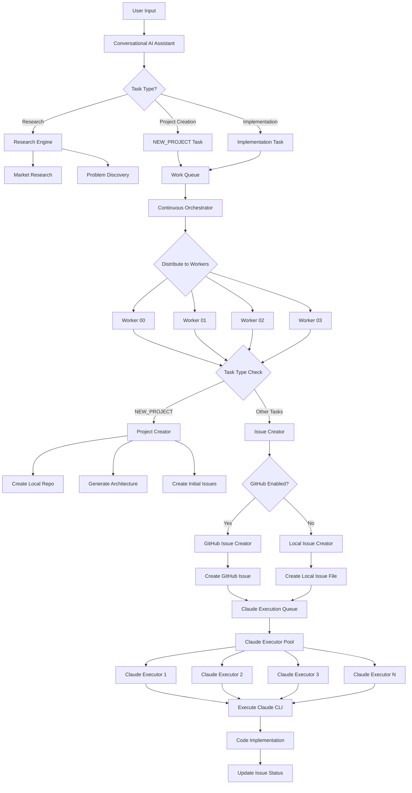

# Hybrid System Flow Diagram

## Overview

The CWMAI system operates as a hybrid between local repository management and GitHub issue tracking, with parallel Claude execution capabilities.

## Complete System Flow



## Component Details

### 1. Entry Points

#### Conversational AI Assistant (`conversational_ai_assistant.py`)
- Receives user requests
- Analyzes intent and routes to appropriate systems
- Maintains conversation history

#### Automatic Work Discovery
- `intelligent_work_finder.py` - Scans repositories for work
- `enhanced_project_opportunity.py` - Discovers market opportunities
- Runs every 30 seconds

### 2. Task Generation

#### Research Tasks
- `research_evolution_engine.py` - Deep market research
- `market_research_engine.py` - Market analysis
- Results feed into project and task generation

#### Implementation Tasks
- `intelligent_task_generator.py` - Creates work items
- Routes to appropriate repositories or creates NEW_PROJECT

### 3. Work Queue System

#### Storage
- **Local Mode**: SQLite database (`ultimate_orchestrator.db`)
- **State Files**: JSON files in `local_repos/state/`
  - `active_tasks.json` - Currently executing
  - `completed_tasks.json` - Finished tasks
  - `task_state.json` - Task tracking

#### Queue Management
- `smart_redis_integration.py` - Manages work queue
- No timeouts - tasks can run indefinitely
- FIFO processing with priority support

### 4. Worker System

#### Continuous Orchestrator (`continuous_orchestrator_no_redis.py`)
- Manages 4 concurrent workers (configurable)
- No execution timeouts
- Routes tasks by type:
  - NEW_PROJECT → Project Creator
  - Others → Issue Creator

#### Worker Execution
- Each worker polls queue independently
- Executes one task at a time
- Updates status in real-time

### 5. Project Creation Flow

#### NEW_PROJECT Tasks Only
```
Task Generator → Work Queue → Worker → Project Creator
                                          ↓
                                   Create Local Repo
                                          ↓
                                   Generate Architecture
                                          ↓
                                   Create Initial Issues
```

#### Project Creator (`project_creator.py`)
- Creates repository structure
- Generates comprehensive architecture
- Creates metadata.json
- Generates initial setup issues

### 6. Issue Creation Flow

#### Dual Mode Operation
```
Worker → Issue Creator → GitHub Enabled? → Yes: GitHub API
                                        ↘ No: Local Files
```

#### Issue Creators
- `github_issue_creator.py` - Creates real GitHub issues
- `local_issue_creator.py` - Creates local JSON files
- Both queue Claude execution tasks

### 7. Parallel Claude Execution

#### Claude Execution Queue (`claude_execution_queue.py`)
- Persistent task queue
- Supports multiple concurrent executors
- No automatic timeouts
- Tracks execution status

#### Claude Executor Pool (`claude_executor.py`)
- Multiple executors run in parallel
- Each handles one task at a time
- Progress logged every 30 seconds
- No execution time limits

#### Execution Flow
```
Issue Created → Queue Task → Available Executor → Run Claude CLI
                                                        ↓
                                              Implement Changes
                                                        ↓
                                              Update Issue Status
```

### 8. State Management

#### Local State Files
- `system_state.json` - System configuration
- `continuous_orchestrator_state.json` - Orchestrator metrics
- Repository metadata in each repo

#### No Redis Dependencies
- All state in local files
- SQLite for work queue
- JSON for configuration

## Key Features

### 1. True Parallel Execution
- Multiple Claude processes run simultaneously
- ~2x speedup with parallel execution
- No artificial serialization

### 2. No Timeouts
- Workers run indefinitely
- Claude executions have no time limit
- Tasks complete when done, not when timed out

### 3. Hybrid Operation
- Works with or without GitHub
- Local development mode
- GitHub integration when needed

### 4. Automatic Work Discovery
- Scans repositories every 30 seconds
- Discovers market opportunities
- Creates tasks automatically

### 5. Comprehensive Architecture
- Each project gets full architecture
- 10 detailed sections
- Implementation roadmap

## Performance Characteristics

### Task Processing Times
- Simple tasks: 20-40 seconds
- Feature implementation: 60-180 seconds  
- Complex refactoring: 180-300 seconds
- Architecture generation: 30-60 seconds

### Parallel Speedup
- 2 workers: ~1.8x speedup
- 4 workers: ~3.2x speedup
- Diminishing returns after 6 workers

### Resource Usage
- Each Claude process: ~500MB RAM
- CPU usage varies by task complexity
- Disk I/O for file operations

## Configuration

### Environment Variables
```bash
# API Keys (required)
ANTHROPIC_API_KEY=xxx
OPENAI_API_KEY=xxx
GOOGLE_API_KEY=xxx

# GitHub Integration (optional)
GITHUB_TOKEN=xxx
GITHUB_OWNER=xxx

# Worker Configuration
MAX_WORKERS=4
WORKER_POLL_INTERVAL=5

# Claude Configuration
CLAUDE_TIMEOUT=None  # No timeout
CLAUDE_SKIP_PERMISSIONS=true
```

### Key Files
- `.env.local` - API keys and config
- `CLAUDE.md` - System instructions
- `mcp_config.json` - Tool configurations

## Monitoring

### Logs
- Main orchestrator log shows worker status
- Claude execution progress every 30 seconds
- Error logs for troubleshooting

### Status Files
- `active_tasks.json` - What's running now
- `completed_tasks.json` - Finished tasks
- Worker status in orchestrator state

### Health Checks
```bash
# Check worker status
python3 scripts/worker_status_monitor.py

# Check Claude processes
python3 cleanup_claude_processes.py

# View queue status
python3 scripts/simple_worker_monitor.py
```

## Troubleshooting

### Common Issues

1. **Claude Not Making Changes**
   - Check for "permission" messages in logs
   - Verify `--dangerously-skip-permissions` flag
   - Ensure prompts are clear and specific

2. **Workers Appear Stuck**
   - Normal for long Claude executions
   - Check progress logs (every 30s)
   - No timeouts mean patience required

3. **Parallel Execution Not Working**
   - Verify multiple executor processes running
   - Check queue has multiple tasks
   - Review executor logs

### Debug Commands
```bash
# Test parallel execution
python3 test_parallel_claude_execution.py

# Monitor queue
python3 scripts/claude_execution_queue.py --status

# Check system state
cat local_repos/state/active_tasks.json
```

## Summary

The hybrid system provides:
- Local development without GitHub dependency
- Parallel Claude execution for speed
- No artificial timeouts or limits
- Comprehensive project generation
- Automatic work discovery
- Flexible deployment options

This architecture balances automation with control, allowing both autonomous operation and manual intervention when needed.