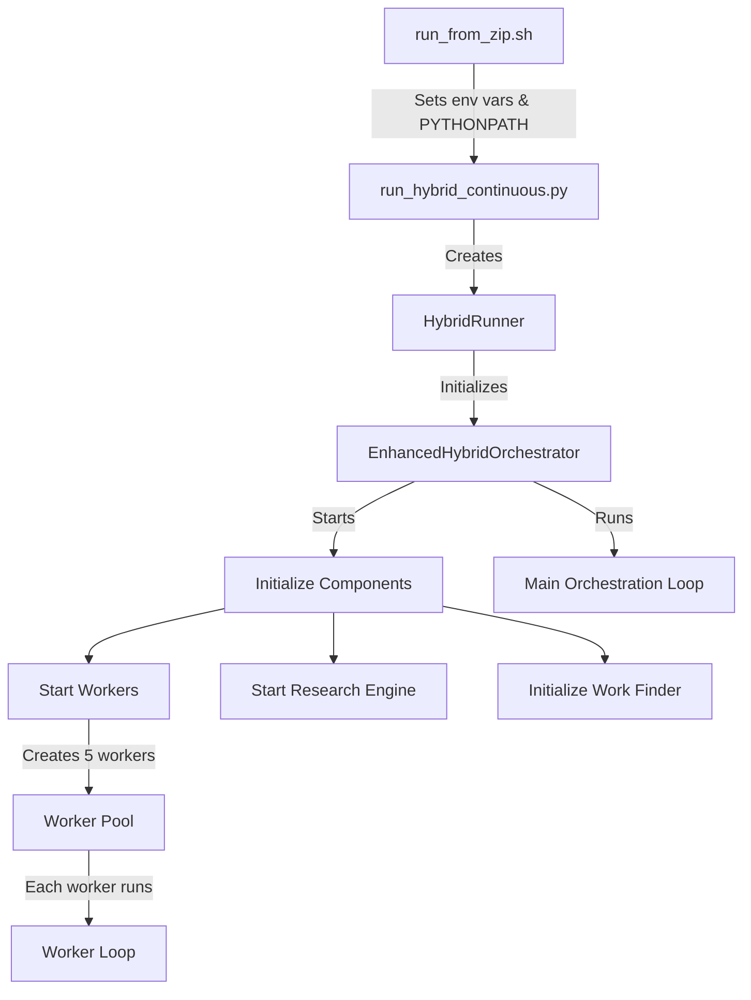
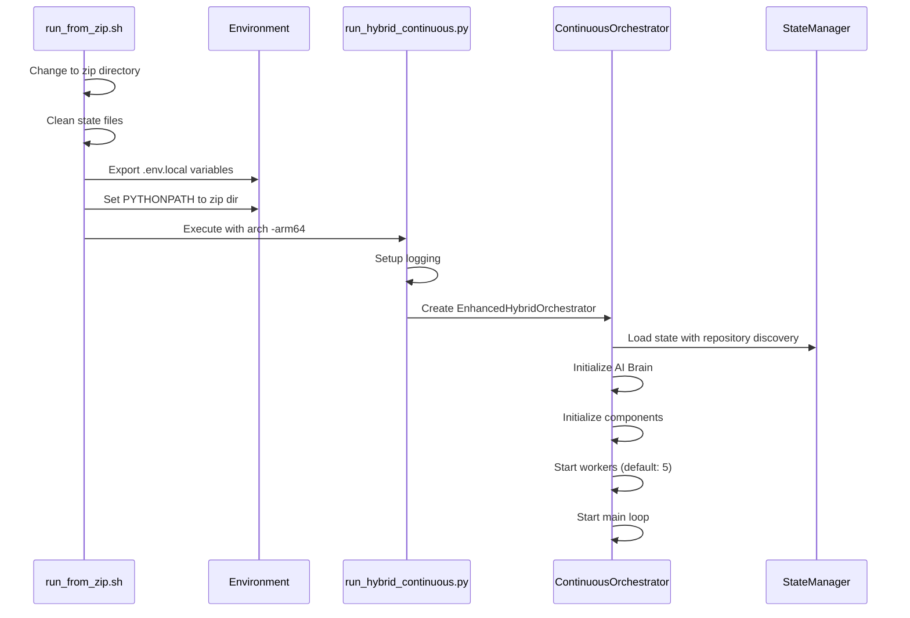
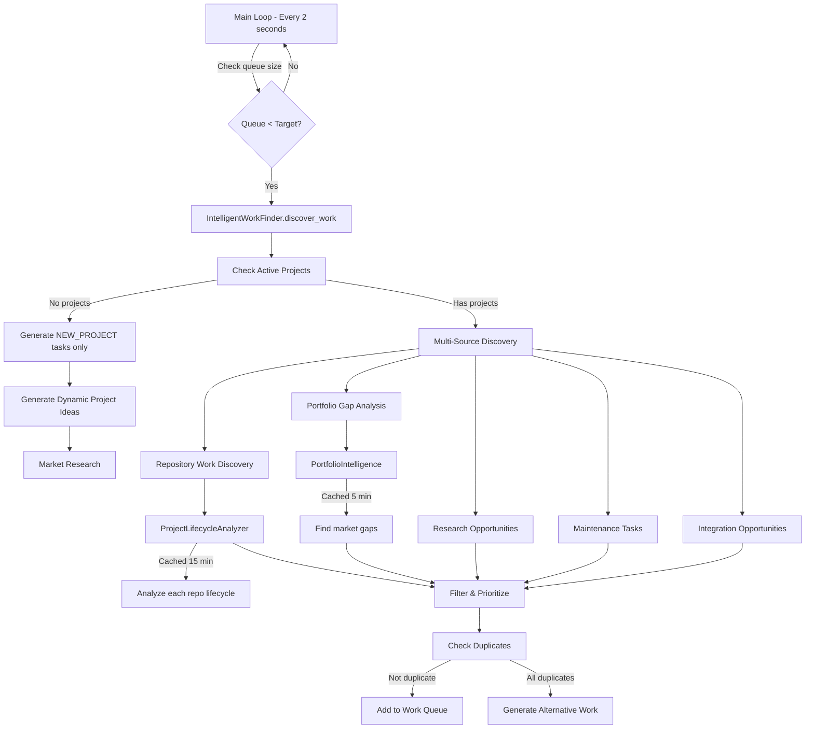
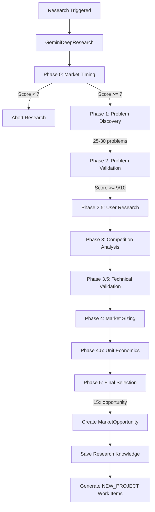
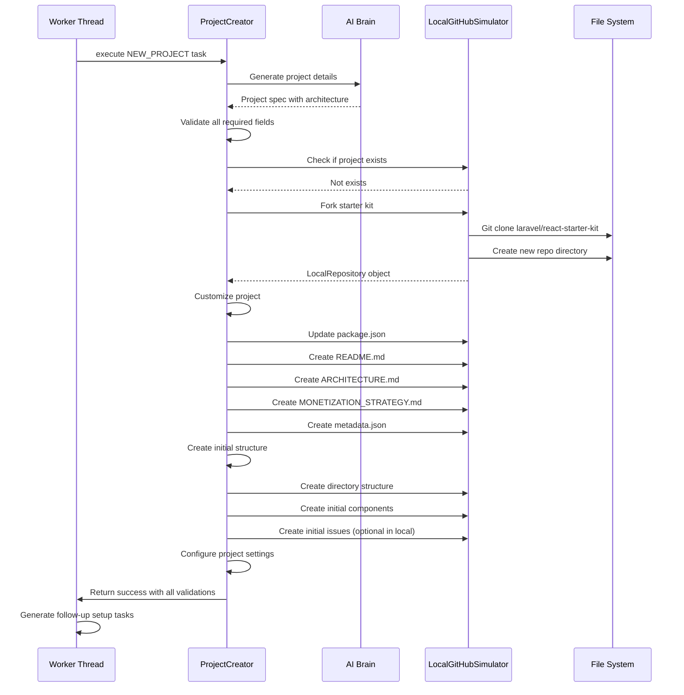
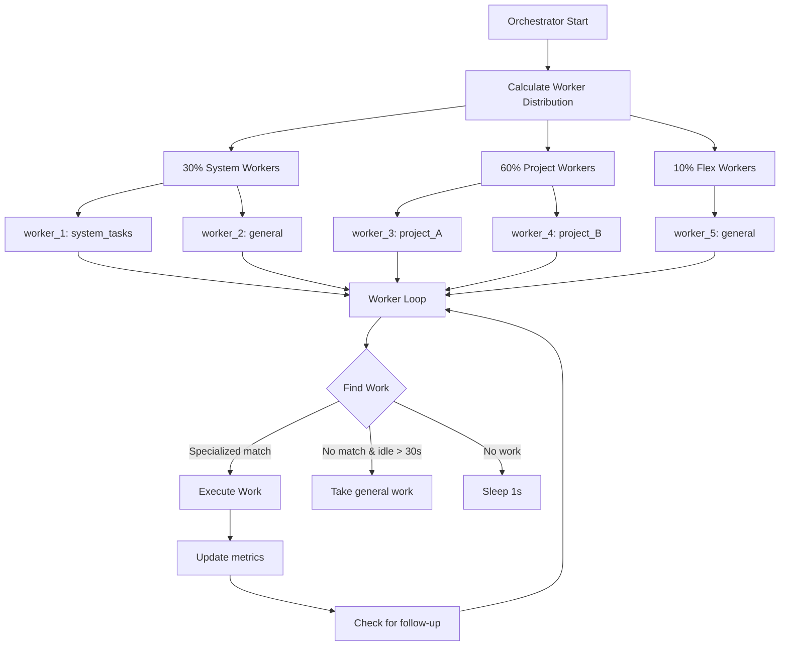
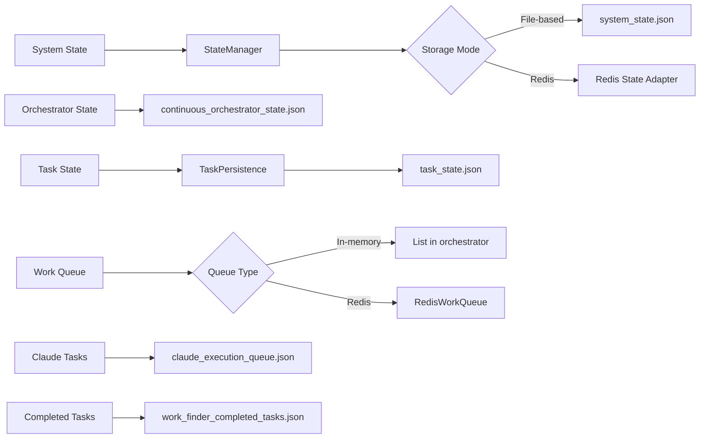

# ZIP Hybrid System Flow Diagram

## System Architecture Overview

The ZIP hybrid system is a sophisticated AI-driven continuous integration system that operates 24/7 to discover work, conduct research, create projects, and manage tasks autonomously.

## System Components

### 1. Entry Points
- **run_from_zip.sh** - Shell script that sets up environment and changes to zip directory
- **run_hybrid_continuous.py** - Python entry point that initializes the hybrid runner
- **EnhancedHybridOrchestrator** - Enhanced orchestrator with research evolution and pattern learning

### 2. Core Orchestrator Flow



## Detailed Flow Diagrams

### System Startup Flow



### Work Discovery Process



### Research Engine Flow (Gemini Deep Research)



### Project Creation Flow



### Worker Management Flow



### State Persistence Flow



### Local Mode Operations

```mermaid
graph TD
    A[LocalGitHubSimulator] --> B[Local Repository Management]
    
    B --> C[Git Operations]
    C --> D[git clone]
    C --> E[git add/commit]
    C --> F[git status]
    
    B --> G[File Operations]
    G --> H[Create/Update files]
    G --> I[Read file contents]
    
    B --> J[Issue Simulation]
    J --> K[issues/ directory]
    J --> L[issue-{number}.json files]
    
    B --> M[Repository Structure]
    M --> N[local_repos/repositories/]
    M --> O[{org}/{repo}/]
```

## Key Decision Points

### 1. Work Discovery Decision
```
IF no active projects exist:
    ONLY generate NEW_PROJECT tasks
ELSE:
    Run full discovery across all sources
    
IF discovered work < target/2:
    Use enhanced work generator
    
IF queue empty:
    Generate emergency work
```

### 2. Worker Assignment Decision
```
IF worker.specialization matches work.repository:
    Assign work
ELIF worker is general:
    Assign any work
ELIF worker idle > 30s AND work is system/general:
    Allow cross-specialization assignment
ELSE:
    Skip this work item
```

### 3. Task Execution Decision
```
IF task is NEW_PROJECT:
    Execute project creation with FULL validation
    ALL steps MUST succeed or entire creation fails
ELSE:
    Queue GitHub issue creation
    Mark task complete immediately
```

### 4. Research Trigger Decision
```
IF market timing score < 7:
    Abort research
    
IF problem validation score < 9:
    Skip problem
    
IF opportunity < 15x:
    Skip opportunity
```

## System Features

### Continuous Operation
- Main loop runs every 2 seconds
- Workers check for work continuously
- No artificial delays except brief sleep when idle

### Intelligent Work Discovery
- Multiple discovery sources
- Caching to reduce API calls (15 min lifecycle, 5 min portfolio)
- Duplicate detection and filtering
- Emergency work generation when queue empty

### Research Evolution
- 9-phase deep market research
- No timeouts - research continues until complete
- All phases data stored for knowledge synthesis
- Validates opportunities with 15x potential

### Project Creation
- Atomic operation - all or nothing
- Full validation at each step
- Comprehensive documentation generation
- Initial project structure setup

### State Management
- Multiple state files for different components
- Periodic state saves
- State restoration on startup
- Support for both file and Redis storage

### Worker Specialization
- Dynamic distribution based on projects
- Specialization with flexibility
- Idle workers can take general tasks
- Balanced workload distribution

## Error Handling

### Failed Tasks
- Exponential backoff cooldown
- Different cooldown strategies by error type
- Task reassignment capability
- Failed task tracking

### Repository Cleanup
- Hourly checks for deleted repositories
- Automatic removal of related work items
- State reload after cleanup

### Graceful Shutdown
- All workers complete current tasks
- State saved before exit
- Clean worker deregistration