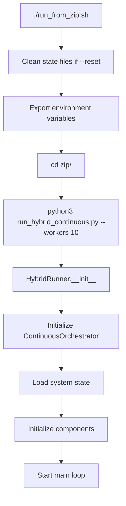
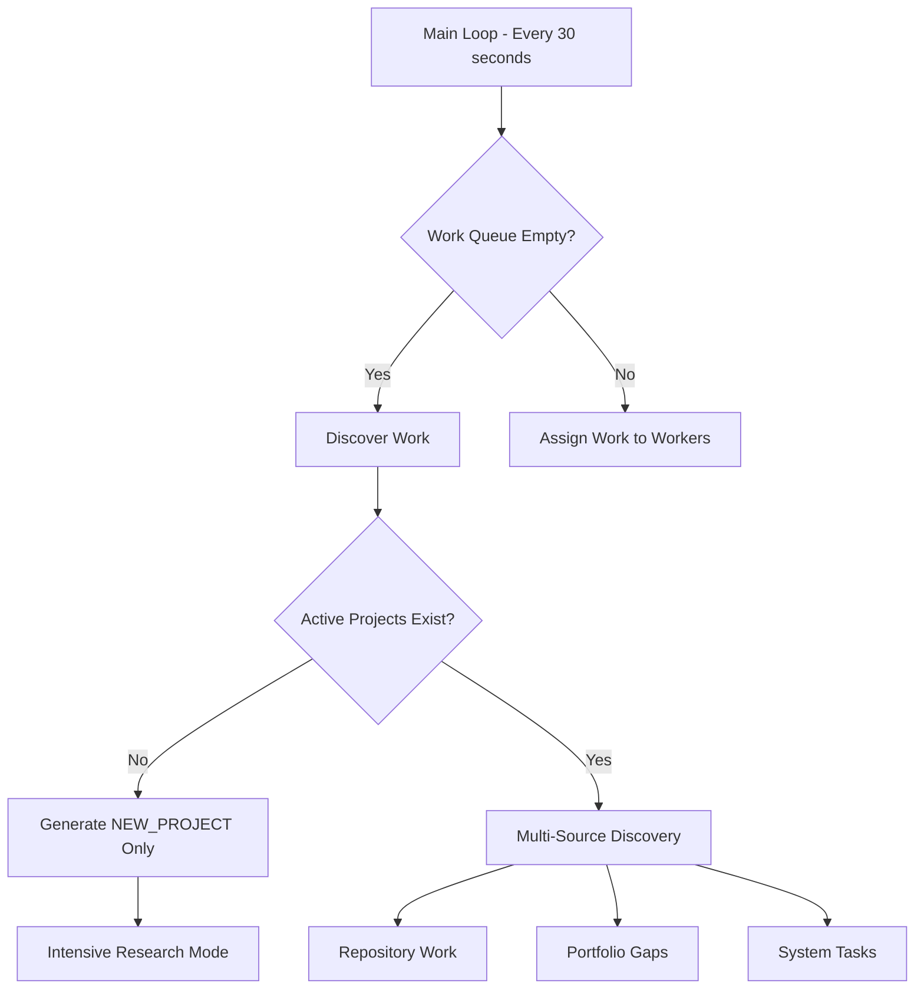
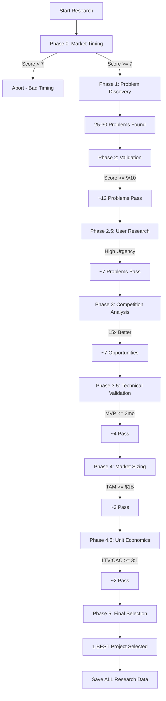
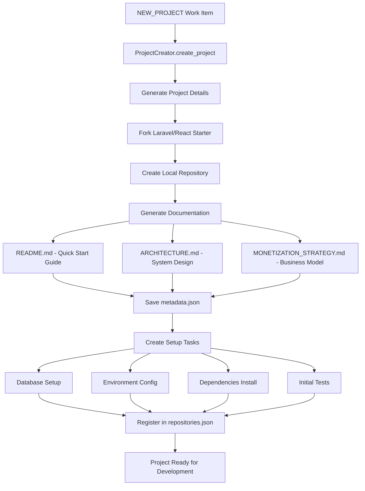
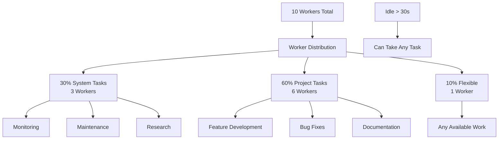
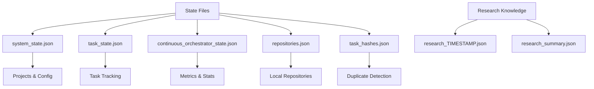
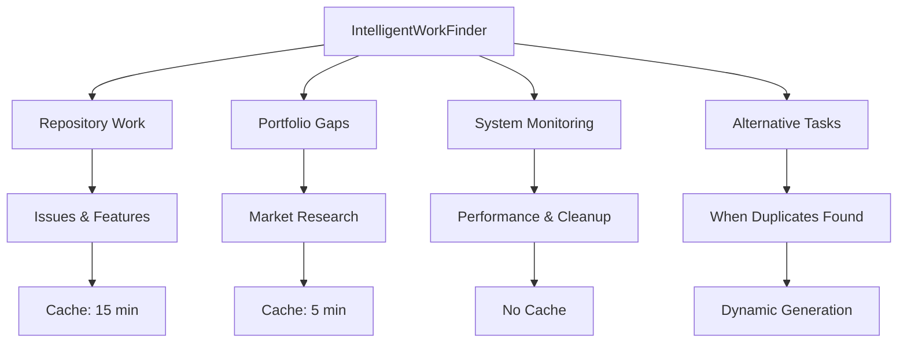
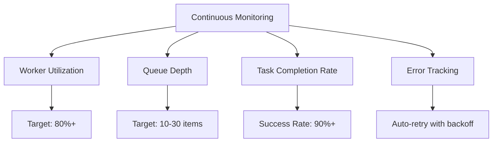
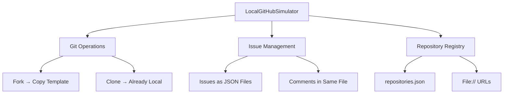

# ZIP Hybrid System Flow Diagram

## 🚀 System Startup



### Key Components Initialized:
1. **StateManager** - Handles system_state.json
2. **IntelligentWorkFinder** - Discovers new work
3. **GeminiDeepResearch** - Market research engine
4. **ProjectCreator** - Creates new projects
5. **LocalGitHubSimulator** - Local Git operations
6. **UnifiedTaskState** - Task tracking
7. **Worker Pool** - Parallel execution (10 workers)

## 🔄 Main Orchestration Loop



## 🔬 Intensive Research Flow (NEW_PROJECT)



### Research Data Saved:
- All 25-30 problems discovered
- Validation scores for each phase
- User stories and workflows
- Competition analysis
- Technical requirements
- Market sizing data
- Unit economics calculations

## 📁 Project Creation Flow



## 👷 Worker Management



### Worker States:
- **IDLE** - Waiting for work
- **WORKING** - Processing task
- **ERROR** - Task failed
- **SHUTTING_DOWN** - Graceful shutdown

## 🗄️ State Management



## 🔍 Work Discovery Sources



## 📊 Key Decision Points

1. **No Projects? → Only NEW_PROJECT tasks**
2. **Research Score < 7? → Abort**
3. **Problem Severity < 8? → Skip**
4. **Validation < 9/10? → Skip**
5. **Not 15x Better? → Skip**
6. **TAM < $1B? → Skip**
7. **LTV:CAC < 3:1? → Skip**
8. **Final Selection → 1 Project Only**

## 🚦 System Health Monitoring



## 💾 Local Mode Operations



## 🔄 Complete Cycle Time

```
Research: 15-30 minutes (no timeouts)
    ↓
Project Creation: 2-5 minutes
    ↓
Setup Tasks: 10-20 minutes
    ↓
Development: Continuous
    ↓
Next Research: After current project progresses
```

## 🎯 System Goals

1. **Quality > Quantity**: 1 exceptional project > 5 mediocre ones
2. **Autonomous Operation**: 24/7 without human intervention
3. **Learning System**: Saves all research for future improvements
4. **Local First**: Everything runs locally, no external dependencies
5. **Intensive Validation**: 9 phases ensure only the best projects

This ZIP hybrid system creates a sustainable, high-quality project pipeline with comprehensive validation at every step.