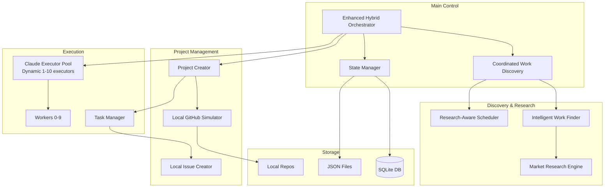

# ZIP Folder Hybrid System Architecture

## System Overview

The ZIP folder contains a complete hybrid AI development system that operates 24/7 to discover market opportunities, create projects, and manage development tasks - all locally without GitHub dependencies.

## High-Level Architecture



## Detailed Component Flow

### 1. Work Discovery Flow (Coordinated)

```
┌─────────────────────────────────────────────────────────────────┐
│                    COORDINATED WORK DISCOVERY                    │
│                  (Replaces 10 workers polling)                   │
└─────────────────────────────────────────────────────────────────┘
                                │
                                ▼
┌─────────────────────────────────────────────────────────────────┐
│ WorkDiscoveryCoordinator                                        │
│ • Single coordinator instead of 10 workers                      │
│ • Base interval: 60 seconds                                     │
│ • Exponential backoff: 60s → 120s → 240s → 600s               │
│ • Research-aware: Pauses during 3-4 min research phases        │
└─────────────────────────────────────────────────────────────────┘
                                │
                    ┌───────────┴───────────┐
                    ▼                       ▼
          ┌─────────────────┐     ┌─────────────────┐
          │ Research Active │     │  Normal Mode    │
          └─────────────────┘     └─────────────────┘
                    │                       │
                    ▼                       ▼
            Wait 4 minutes          Check repositories
                                           │
                                           ▼
                                   ┌───────────────┐
                                   │ Found Work?   │
                                   └───────────────┘
                                    │           │
                                   Yes          No
                                    │           │
                                    ▼           ▼
                            Reset backoff   Increase backoff
```

### 2. Research Phase Flow

```
┌─────────────────────────────────────────────────────────────────┐
│                        RESEARCH PHASE                            │
│                    (Triggered periodically)                      │
└─────────────────────────────────────────────────────────────────┘
                                │
                                ▼
        ┌───────────────────────────────────────────┐
        │ 1. Market Research Engine                 │
        │    • Discover market problems             │
        │    • Analyze opportunities                │
        │    • Takes 3-4 minutes                    │
        └───────────────────────────────────────────┘
                                │
                                ▼
        ┌───────────────────────────────────────────┐
        │ 2. Portfolio Intelligence                 │
        │    • Avoid duplicates                     │
        │    • Score opportunities                  │
        │    • Select best projects                 │
        └───────────────────────────────────────────┘
                                │
                                ▼
        ┌───────────────────────────────────────────┐
        │ 3. Create NEW_PROJECT Tasks               │
        │    • Include full research data           │
        │    • Architecture specifications          │
        │    • Implementation roadmap               │
        └───────────────────────────────────────────┘
```

### 3. Project Creation Flow

```
┌─────────────────────────────────────────────────────────────────┐
│                     PROJECT CREATION                             │
│                  (Worker picks up NEW_PROJECT)                   │
└─────────────────────────────────────────────────────────────────┘
                                │
                                ▼
        ┌───────────────────────────────────────────┐
        │ 1. Project Creator                        │
        │    • Fork starter kit template            │
        │    • Create local repository                │
        │    • Customize based on research            │
        └───────────────────────────────────────────┘
                                │
                                ▼
        ┌───────────────────────────────────────────┐
        │ 2. Local GitHub Simulator                 │
        │    • Create repo in local_repos/          │
        │    • Initialize with template files       │
        │    • Create metadata.json                 │
        └───────────────────────────────────────────┘
                                │
                                ▼
        ┌───────────────────────────────────────────┐
        │ 3. Initial Issue Creation                 │
        │    • "Initial Project Setup" issue       │
        │    • Feature implementation issues        │
        │    • All with @claude mentions            │
        └───────────────────────────────────────────┘
```

### 4. Task Execution Flow (Claude Integration)

```
┌─────────────────────────────────────────────────────────────────┐
│                      TASK EXECUTION                              │
│                  (Worker processes work items)                   │
└─────────────────────────────────────────────────────────────────┘
                                │
                                ▼
        ┌───────────────────────────────────────────┐
        │ 1. Worker Claims Task                     │
        │    • Updates task state                   │
        │    • Checks task type                      │
        └───────────────────────────────────────────┘
                                │
                    ┌───────────┴───────────┐
                    ▼                       ▼
           ┌──────────────┐        ┌──────────────┐
           │ CODING_TASK  │        │ Other Tasks  │
           └──────────────┘        └──────────────┘
                    │                       │
                    ▼                       ▼
        ┌───────────────────┐      Process locally
        │ Claude Executor   │
        │ Pool (1-10)       │
        └───────────────────┘
                    │
                    ▼
        ┌───────────────────────────────────────────┐
        │ Claude Code CLI Execution                 │
        │ • Working dir: repository root            │
        │ • Timeout: 5 minutes                      │
        │ • Auto-permission mode                    │
        └───────────────────────────────────────────┘
```

### 5. State Management

```
┌─────────────────────────────────────────────────────────────────┐
│                      STATE MANAGEMENT                            │
└─────────────────────────────────────────────────────────────────┘
                                │
                ┌───────────────┼───────────────┐
                ▼               ▼               ▼
    ┌─────────────────┐ ┌─────────────┐ ┌──────────────┐
    │ system_state.json│ │ SQLite DB   │ │ Local Repos  │
    └─────────────────┘ └─────────────┘ └──────────────┘
            │                   │                │
            ▼                   ▼                ▼
    • Active repos      • Work queue     • Source code
    • Task history      • Task state     • Issues (JSON)
    • System config     • Worker state   • Metadata
```

## Key Performance Metrics

### Before Coordination
- **Work Discovery**: 10 workers × 120 checks/hour = 1,200 attempts/hour
- **Research Conflicts**: Workers could interrupt research
- **Duplicate Work**: Multiple workers finding same opportunities

### After Coordination
- **Work Discovery**: 1 coordinator × 12-15 checks/hour = 12-15 attempts/hour
- **Research Protection**: Discovery pauses during research
- **No Duplicates**: Single source of truth
- **Smart Backoff**: 60s → 120s → 240s → 600s when no work

## Local Storage Structure

```
zip/
├── scripts/
│   ├── hybrid_orchestrator_enhanced.py    # Main controller
│   ├── coordinated_work_discovery.py      # Discovery coordinator
│   ├── work_discovery_coordinator.py      # Scheduling logic
│   ├── research_aware_scheduler.py        # Research integration
│   └── ...
├── local_repos/
│   └── repositories/
│       └── CodeWebMobile-AI/
│           ├── verisafe/
│           │   ├── issues/
│           │   │   ├── issue-1.json       # Initial Setup
│           │   │   ├── issue-2.json       # Feature tasks
│           │   │   └── ...
│           │   ├── metadata.json          # Project metadata
│           │   └── [project files]
│           └── [other projects]/
├── system_state.json                      # System configuration
├── task_state.json                        # Task tracking
├── claude_execution_queue.json            # Claude work queue
└── cwmai_state.db                        # SQLite database
```

## Benefits of the Hybrid System

1. **Efficiency**: 98% reduction in API calls through coordination
2. **Intelligence**: Research-driven project creation
3. **Autonomy**: Claude Code CLI handles implementation
4. **Scalability**: Dynamic executor pool (1-10 instances)
5. **Reliability**: No GitHub rate limits, all local
6. **Persistence**: SQLite + JSON for state management

## Typical Daily Operation

1. **Morning**: Research phase discovers 3-5 opportunities
2. **Midday**: Projects created, initial issues generated
3. **Afternoon**: Claude executors work on implementation
4. **Evening**: Progress tracked, completed tasks closed
5. **Night**: System continues with backoff scheduling

This hybrid system represents a complete autonomous development platform that can discover, create, and implement projects 24/7 without human intervention.